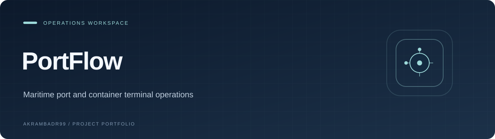
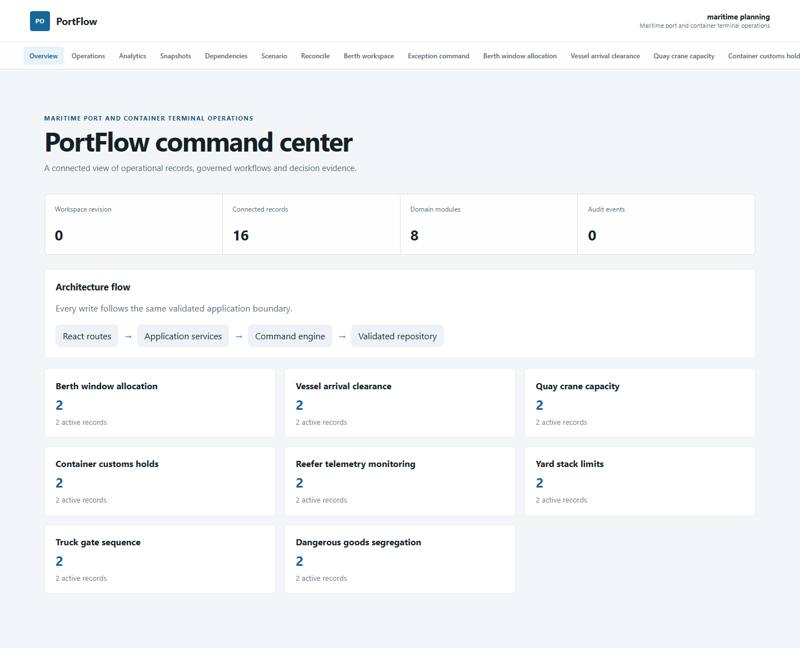

<p align="center">
  
</p>

<p align="center"><strong>Maritime port and container terminal operations</strong></p>

<p align="center"><a href="#overview">Overview</a> · <a href="#explore">Explore</a> · <a href="#getting-started">Getting started</a></p>

<p align="center"><code>React</code> · <code>TypeScript</code> · <code>Vite</code></p>

## Overview

**PortFlow** is a React and TypeScript application for maritime port and container terminal operations. Explore its records, workflows, and operational views from the local workspace.

This project belongs to a related operations-application portfolio and shares foundation code and conventions with sibling repositories.



*Actual application capture using local fixture data.*

## Explore

- Berth window allocation
- Vessel arrival clearance
- Quay crane capacity
- Container customs holds
- Reefer telemetry monitoring
- Yard stack limits
- Truck gate sequence
- Dangerous goods segregation

## Getting started

Node.js requirement: `>=20.19 <21`. Use the package manager specified in [package.json](package.json).

```bash
git clone https://github.com/Akrambadr99/PortFlow.git
cd PortFlow
npm ci
npm run dev
```

Open the URL printed by the development server.

### Development commands

| Command | Script defined by this project |
| --- | --- |
| `npm run dev` | `vite` |
| `npm run typecheck` | `tsc -b` |
| `npm run lint` | `eslint . --max-warnings 0` |
| `npm run test` | `vitest run` |
| `npm run test:e2e` | `playwright test` |
| `npm run build` | `npm run typecheck && vite build && node scripts/check-entry-budget.mjs` |

See the project guide below for browser installation and any service-specific setup.

## Project notes

The preview uses local fixture data. Workflow and role controls demonstrate application behavior; this page does not imply a certified, hosted, or production-integrated service.

<details>
<summary><strong>Project guide, technical details, and existing documentation</strong></summary>

# PortFlow

Maritime port and container terminal operations. A local-first React 19 operations platform with typed records, versioned commands, role-separated workflow transitions, cross-record validation, retry-safe receipts, immutable audit evidence, analytics, and direct Chromium journeys.

## Runtime

- Node 20.19.x
- npm 10.8.2
- npm ci
- npm run check
- npm run test:e2e

No external service is required. All deterministic fixtures and persistence adapters are local.

</details>

---

<p align="center"><a href="https://github.com/Akrambadr99?tab=repositories">Explore the portfolio</a></p>
